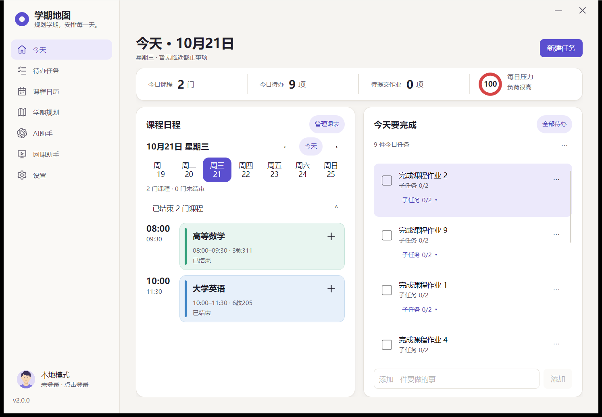
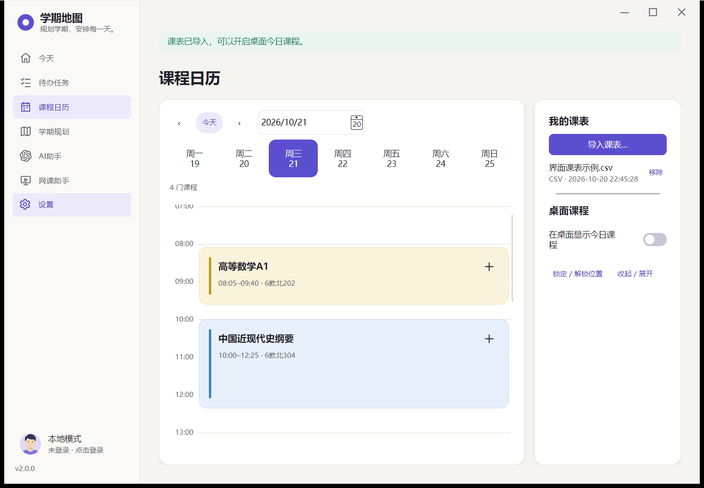
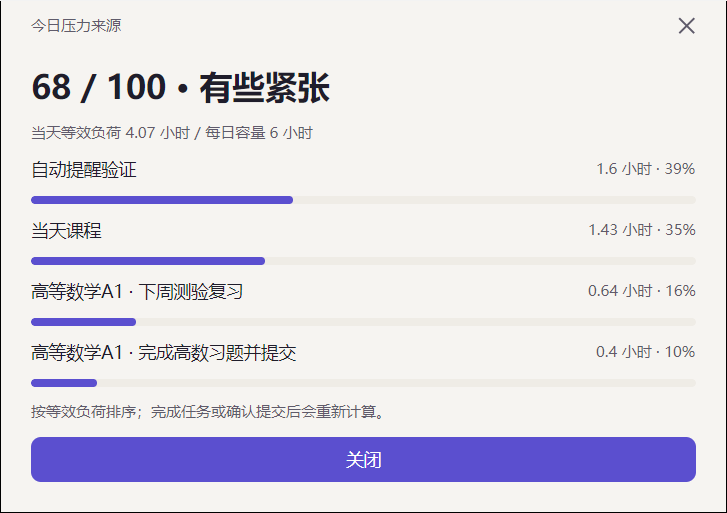
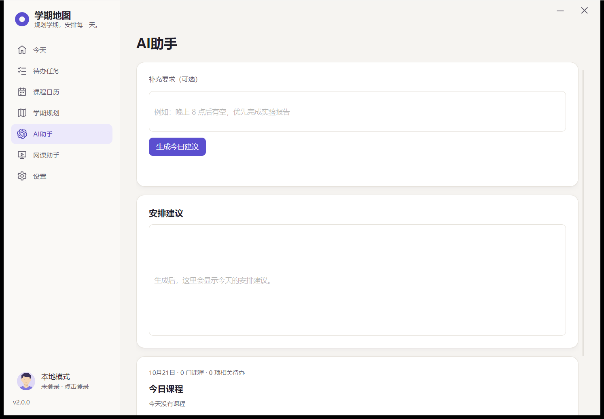
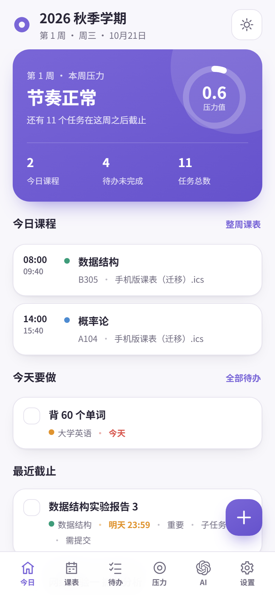
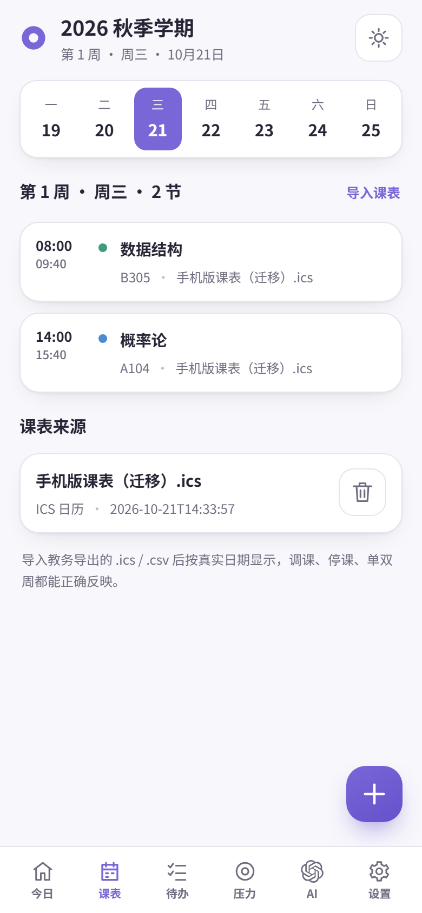
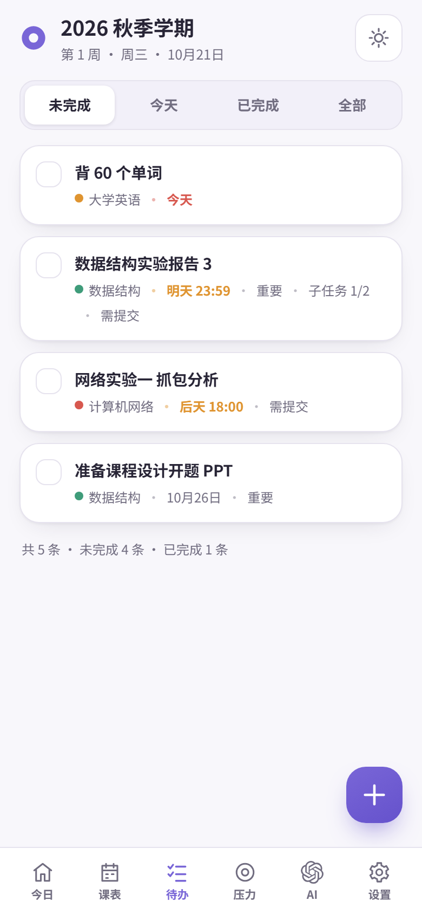
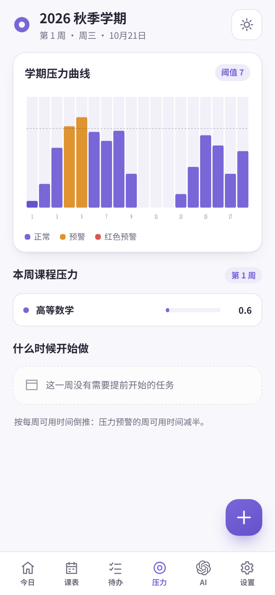
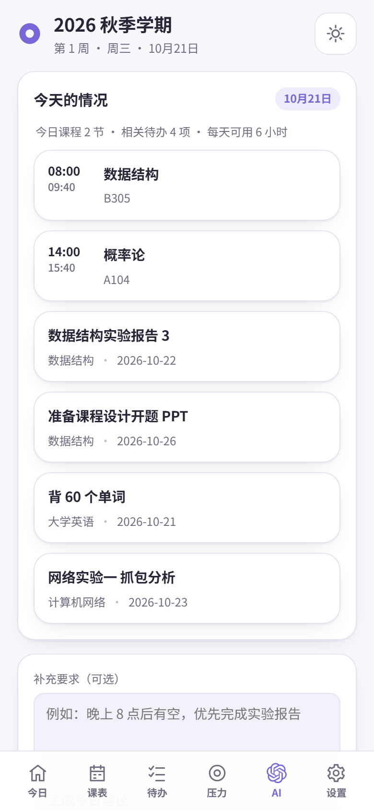
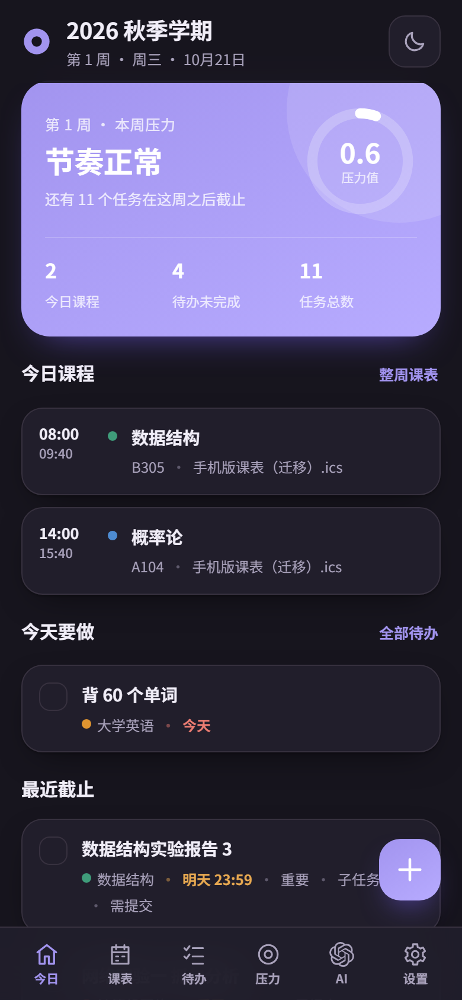

# 🟣 学期压力地图

### PressureMap · 课表、任务与学习压力，一屏掌握

**🖥️ 桌面应用　 ·　 📱 移动应用　 ·　 ☁️ 云端同步　 ·　 🌐 官方网站**

📅 看清安排　 ·　 ✅ 跟进任务　 ·　 📊 提前准备

## 🧭 今天要做什么

| 🏠 今日概览 | ⏰ 截止时间 | 📤 提交追踪 |
| :--- | :--- | :--- |
| 集中查看今日课程、待办和待提交数量，优先展示正在上课或下一节课。 | 标出逾期和最近截止事项，截止时间可精确到时分。 | “做完”和“提交”分别记录，已完成但尚未提交的作业继续保留。 |

## 📅 课程日历

**📥 导入课表 → 👀 检查预览 → 🗓️ 查看每天的课程**

- **多格式导入**：ICS、UTF-8 CSV，以及杭电教务导出的文字版 PDF；PDF 按对应学期校历展开。
- **周次与调课**：ICS 支持每周、单双周、停课例外和调课。
- **上课信息**：查看时间、教室，以及正在上课 / 未开始 / 已结束状态。
- **独立管理**：重复导入同名文件更新原课表，可单独移除某份课表。

## ✅ 待办与作业

| 功能 | 可以做什么 |
| :--- | :--- |
| 🏷️ 课程关联 | 为任务关联课程，填写类型、预计耗时和截止日期。 |
| 🧩 子任务 | 将任务拆成步骤，逐项勾选并查看完成进度。 |
| ⭐ 重要标记 | 标记需要优先处理的事项。 |
| 📤 提交状态 | 分别记录“完成”和“提交”，避免做完忘交。 |
| 🔎 清单管理 | 搜索、筛选、批量完成；桌面端可撤销最近删除。 |
| 🔁 重复任务 | 桌面端按设定间隔生成下一次任务，重置子任务进度。 |
| 💤 延后安排 | 桌面端可把安排推迟到明天，保留原始截止日期。 |
| 🔔 截止提醒 | 桌面端在截止前一天、一小时和到期时提醒，可延后 15 分钟；需保持程序运行。 |

## 📊 压力分析与开工建议

| 🎯 每日压力 | 🗓️ 学期压力 | 🛠️ 提前开工 |
| :--- | :--- | :--- |
| 桌面端以 **0–100 分圆环**展示当天负荷，结合课时、任务耗时、类型、紧迫度及子任务进度计算。 | 按周查看压力分布，提前发现考试、报告和大作业集中的时段。 | 根据每周可用时间和截止周，向前分配准备时间。 |

⚙️ 每日容量可调整　 ·　 📥 学期任务可导入待办　 ·　 📈 查看压力来源

## 🪟 桌面玻璃组件

Windows 桌面提供三个独立组件：**✅ 待办清单 · 📚 今日课程 · 🎯 每日压力**。

🫧 磨砂玻璃　 🔒 位置锁定　 ↔️ 拖动缩放　 📌 边缘吸附　 🗂️ 折叠收起　 🖱️ 鼠标穿透

组件贴在桌面层，不占任务栏；关闭主窗口后可通过系统托盘继续使用。

## ✨ AI 今日安排

将 **当天课程、相关待办、截止时间、预计耗时和补充要求** 组合成学习安排建议。

- 🕒 **时间安排**：考虑固定课时、当前时间和每日容量，给出学习时段与休息建议。
- 🚩 **任务排序**：结合重要标记、截止日期和完成进度确定优先级。
- 💬 **个人要求**：可补充“晚上八点后有空，优先完成实验报告”等条件。
- 🔌 **接口选择**：桌面端可使用默认服务或自定义 OpenAI 兼容接口；移动端需配置接口地址、模型和 API Key。

生成结果供你确认，**不会自动修改任务**。

## 🎓 网课进度

**支持学习通、中国大学 MOOC / SPOC。**

🖥️ **桌面端**：登录后读取课程任务，按任务点、课件、作业、测验、讨论等分类查看要求、已完成、剩余和进度；支持排序和调整表格列宽，无法确认的数据单独标记。

📱 **Android 端**：在应用内课程窗口登录并打开课程页，点击“读取这一页”，提取当前页可识别的课程、进度和作业截止信息。

只读取学习进度，不自动播放、答题或提交作业。查看 [📖 网课助手说明](pressure-map/docs/ONLINE_COURSES.md)。

## 📱 手机界面

**🏠 今日 · 📅 课表 · ✅ 待办 · 📊 压力 · ✨ AI · ⚙️ 设置**

<table>
<tr>
<td width="33%" align="center"> <b>🏠 今日概览</b></td>
<td width="33%" align="center"> <b>📅 课程日历</b></td>
<td width="33%" align="center"> <b>✅ 待办清单</b></td>
</tr>
<tr>
<td width="33%" align="center"> <b>📊 学期压力</b></td>
<td width="33%" align="center"> <b>✨ AI 助手</b></td>
<td width="33%" align="center"> <b>🌙 深色模式</b></td>
</tr>
</table>

🎨 浅色 / 深色 / 跟随系统　 ·　 🌏 中文 / English　 ·　 💾 本地保存与 JSON 备份

包含 Android WebView、iOS WKWebView 工程和移动网页版。iOS 安装包需在 macOS 上使用 Xcode 构建并签名。

## ☁️ 账号、同步与备份

| 功能 | 说明 |
| :--- | :--- |
| 👤 账号管理 | 注册、登录、退出与修改密码，各账号数据隔离。 |
| 🔄 多设备同步 | 同一账号同步学期、课程、课表和待办；桌面端支持定时检查和离线重试，移动端提供账号同步入口。 |
| ⚖️ 冲突处理 | 通过快照版本号检测并发修改；桌面端备份双方版本后供用户选择。 |
| 💾 本地备份 | JSON 导入 / 导出；桌面端支持自动日备份、历史备份预览和恢复。 |
| 🗄️ 云端存储 | SQLite 持久化，保留最近 5 个历史快照，支持登录限流和在线数据库备份。 |

## 🗂️ 源码入口

| 项目 | 代码与文档 |
| :--- | :--- |
| 🖥️ 桌面端 · .NET 10 / Avalonia | [pressure-map](pressure-map/) · [开发说明](pressure-map/README.md#源码开发) |
| 📱 移动端 · HTML / CSS / JavaScript | [pressure-map-mobile](pressure-map-mobile/) · [安装说明](pressure-map-mobile/docs/INSTALL.md) |
| ☁️ 服务端 · ASP.NET Core / SQLite | [pressure-map-server](pressure-map-server/) · [API](pressure-map-server/API.md) · [部署](pressure-map-server/DEPLOY.md) |
| 🌐 官网 · 静态页面与交互演示 | [pressure-map-website](pressure-map-website/) · [部署说明](pressure-map-website/DEPLOY.md) |
